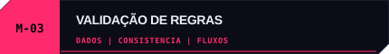
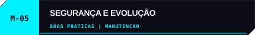
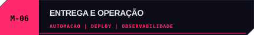

  
  
<b>Construo sistemas corporativos com foco em clareza, resiliência e automação.</b>

  
  
  

 

Sou **Guilherme Damasceno**, desenvolvedor full stack na **Develcode**. Trabalho com back-end, APIs e integração entre serviços, além de modernização de sistemas e automação. Minha stack principal é **Java / Spring Boot** e **C# / .NET**; também desenvolvo integrações e agentes de IA com **Python** e exploro web e mobile em projetos próprios.

 

Atuo em equipes de desenvolvimento de sistemas corporativos, com foco em back-end, integração de serviços e automação.

<table>
  <tr>
    <td width="50%" valign="top">
      
      
<b>Missão ·</b> conectar serviços de forma consistente. 
      <b>Ação ·</b> desenvolvi fluxos de integração com tratamento de falhas e rastreabilidade. 
      <b>Resultado ·</b> comunicação entre sistemas mais organizada e simples de acompanhar.

    </td>
    <td width="50%" valign="top">
      
      
<b>Missão ·</b> manter os fluxos preparados para imprevistos. 
      <b>Ação ·</b> tratei falhas temporárias, erros e respostas incompletas. 
      <b>Resultado ·</b> comportamentos mais previsíveis durante a execução.

    </td>
  </tr>
  <tr>
    <td width="50%" valign="top">
      
      
<b>Missão ·</b> validar informações antes do processamento. 
      <b>Ação ·</b> implementei regras de validação e feedback para dados incompletos. 
      <b>Resultado ·</b> fluxos mais claros e consistentes.

    </td>
    <td width="50%" valign="top">
      
      
<b>Missão ·</b> apoiar a evolução confiável das aplicações. 
      <b>Ação ·</b> revisei componentes e ampliei cenários de teste. 
      <b>Resultado ·</b> mudanças acompanhadas por verificações mais abrangentes.

    </td>
  </tr>
  <tr>
    <td width="50%" valign="top">
      
      
<b>Missão ·</b> contribuir para sistemas mais seguros e sustentáveis. 
      <b>Ação ·</b> tratei riscos de software e melhorei aspectos de manutenção. 
      <b>Resultado ·</b> aplicações mais preparadas para evoluir.

    </td>
    <td width="50%" valign="top">
      
      
<b>Missão ·</b> apoiar a entrega e o acompanhamento dos serviços. 
      <b>Ação ·</b> contribuí com automação, deploys e observabilidade. 
      <b>Resultado ·</b> processos de entrega mais organizados.

    </td>
  </tr>
  <tr>
    <td colspan="2" valign="top">
      
      
<b>Contexto ·</b> manutenção e evolução de aplicações existentes. 
      <b>Ação ·</b> modernizei componentes, revisei a persistência de dados e investiguei regras de negócio.

    </td>
  </tr>
</table>

Também desenvolvo automações com **n8n**, **Python** e **JavaScript** para apoiar processos de trabalho.

 

<table>
  <tr>
    <td width="50%" valign="top">
      
      
App de leitura em inglês com histórias, filtros por nível CEFR e exercícios de completar lacunas. 
      <a href="https://english-reading-app.pages.dev">ABRIR APP ↗</a> · <a href="https://github.com/Guilhermedms7/english-reading-app">CÓDIGO ↗</a>

    </td>
    <td width="50%" valign="top">
      
      
E-commerce full stack com catálogo, busca, ofertas e carrinho, conectado a API e banco de dados. 
      <a href="https://github.com/Guilhermedms7/DMSTECH2.0">VER REPOSITÓRIO ↗</a>

    </td>
  </tr>
  <tr>
    <td width="50%" valign="top">
      
      
Aplicação full stack para cadastro e gerenciamento de livros e usuários. 
      <a href="https://github.com/Guilhermedms7/DMSBOOKS">VER REPOSITÓRIO ↗</a>

    </td>
    <td width="50%" valign="top">
      
      
Aplicativo mobile de delivery desenvolvido com Flutter. 
      <a href="https://github.com/Guilhermedms7/DMSPIBURGUER">VER REPOSITÓRIO ↗</a>

    </td>
  </tr>
  <tr>
    <td width="50%" valign="top">
      
      
Jogo de palavras no navegador com os modos Termo, Dueto e Quarteto. 
      <a href="https://github.com/Guilhermedms7/Termo">VER REPOSITÓRIO ↗</a>

    </td>
    <td width="50%" valign="top">
      
      
Projeto em Python para operações com clientes, agências e contas. 
      <a href="https://github.com/Guilhermedms7/Sistema_bancario">VER REPOSITÓRIO ↗</a>

    </td>
  </tr>
</table>

 

 

  
Vamos conversar sobre oportunidades, projetos ou desenvolvimento de software.

  
  
  
    
  

