

  <a href="https://guilherme-damasceno.pages.dev">
    
  </a>
    
  
  
  
  

 

  

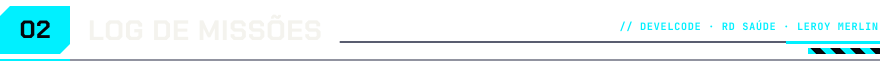
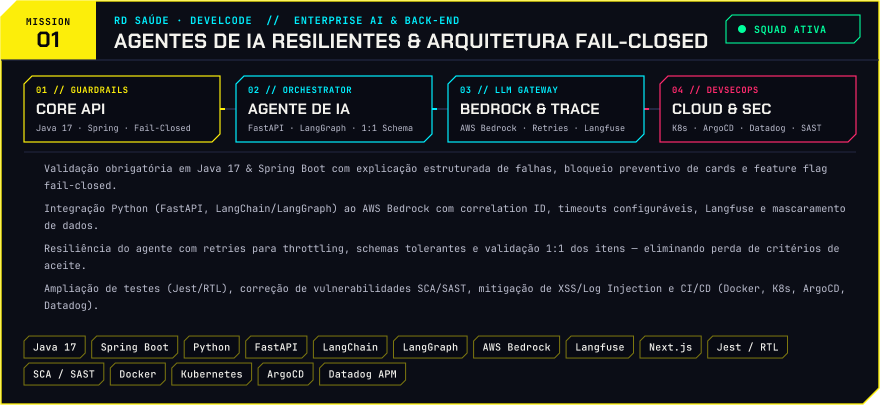
  
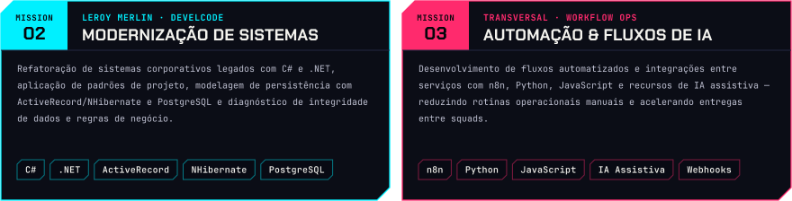

  

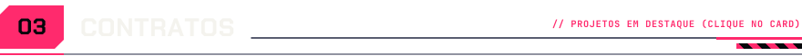

  <a href="https://english-reading-app.pages.dev">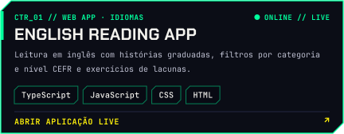</a>
  <a href="https://github.com/Guilhermedms7/DMSTECH2.0">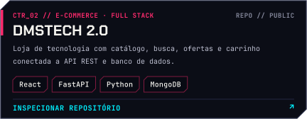</a>

  <a href="https://github.com/Guilhermedms7/DMSBOOKS">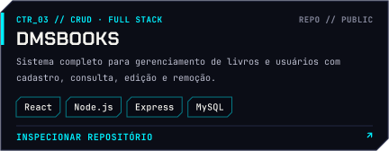</a>
  <a href="https://github.com/Guilhermedms7/DMSPIBURGUER">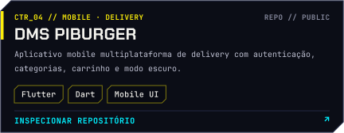</a>

  <a href="https://github.com/Guilhermedms7/Termo">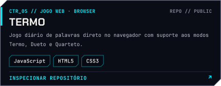</a>
  <a href="https://github.com/Guilhermedms7/Sistema_bancario">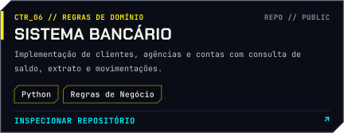</a>

 

  

   
  
  
  
  
    
  

