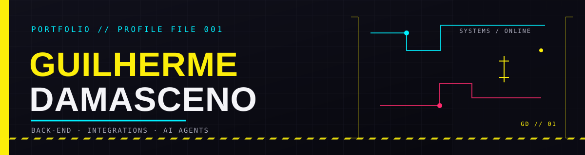

  

  <h3>DESENVOLVEDOR FULL STACK · BACK-END · INTEGRAÇÕES · IA</h3>
  
Construo soluções para sistemas corporativos — com foco em clareza, resiliência e automação.

  
  
   
  <a href="https://github.com/Guilhermedms7/Portifolio/tree/main/portfolio">CÓDIGO-FONTE DO PORTFÓLIO ↗</a>

---

### `01 // PERFIL`

Sou **Guilherme Damasceno**, desenvolvedor full stack na **Develcode**. Trabalho com back-end, APIs e integração entre serviços, além de modernização de sistemas e automação.

Minha stack principal é **Java / Spring Boot** e **C# / .NET**. Também desenvolvo integrações e agentes de IA com Python e exploro tecnologias web e mobile em projetos próprios.

> **FORMAÇÃO** · Análise e Desenvolvimento de Sistemas — UNISO 
> **EM ANDAMENTO** · Engenharia de Software — Estácio

### `02 // PROJETOS EM DESTAQUE`

<table>
  <tr>
    <td width="50%" valign="top">
      
      
App de leitura em inglês com histórias, filtros por nível CEFR e exercícios de completar lacunas.

      <a href="https://english-reading-app.pages.dev">ABRIR APP ↗</a> ·
      <a href="https://github.com/Guilhermedms7/english-reading-app">CÓDIGO ↗</a>
    </td>
    <td width="50%" valign="top">
      
      
E-commerce full stack com catálogo, busca, ofertas e carrinho, conectado a API e banco de dados.

      <a href="https://github.com/Guilhermedms7/DMSTECH2.0">VER REPOSITÓRIO ↗</a>
    </td>
  </tr>
  <tr>
    <td width="50%" valign="top">
      
      
Aplicação full stack para cadastro e gerenciamento de livros e usuários.

      <a href="https://github.com/Guilhermedms7/DMSBOOKS">VER REPOSITÓRIO ↗</a>
    </td>
    <td width="50%" valign="top">
      
      
Aplicativo mobile de delivery com Flutter.

      <a href="https://github.com/Guilhermedms7/DMSPIBURGUER">VER REPOSITÓRIO ↗</a>
    </td>
  </tr>
  <tr>
    <td width="50%" valign="top">
      
      
Jogo de palavras no navegador com os modos Termo, Dueto e Quarteto.

      <a href="https://github.com/Guilhermedms7/Termo">VER REPOSITÓRIO ↗</a>
    </td>
    <td width="50%" valign="top">
      
      
Projeto em Python para operações com clientes, agências e contas.

      <a href="https://github.com/Guilhermedms7/Sistema_bancario">VER REPOSITÓRIO ↗</a>
    </td>
  </tr>
</table>

### `03 // STACK`

**BACK-END**

**IA, INTEGRAÇÃO & RESILIÊNCIA**

**WEB, DADOS & ENTREGA**

### `04 // CANAL ABERTO`

  
  
  
    
  GUILHERME DAMASCENO · BACK-END · INTEGRAÇÕES · IA

