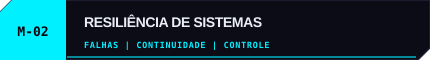
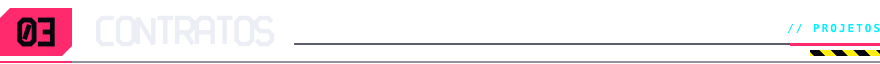
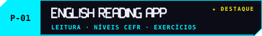
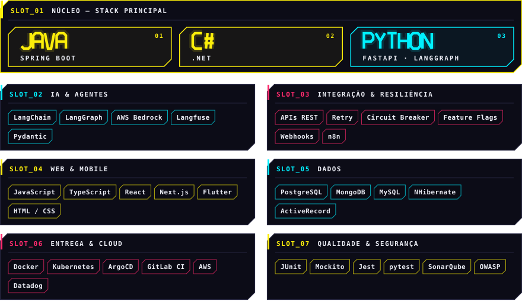

  
  
<b>Construo sistemas corporativos com foco em clareza, resiliência e automação.</b>

  
  
  

 

Sou **Guilherme Damasceno**, desenvolvedor full stack na **Develcode**. Atuo em squads da RD Saúde e da Leroy Merlin, trabalhando com back-end, integrações, modernização de sistemas e automação.

Minha stack principal é **Java / Spring Boot** e **C# / .NET**. Também trabalho com Python, agentes de IA, n8n e tecnologias web e mobile em projetos próprios.

> **FORMAÇÃO** · Análise e Desenvolvimento de Sistemas — UNISO 
> **EM ANDAMENTO** · Engenharia de Software — Estácio

 

Na RD Saúde, contribuo com serviços que apoiam a geração e validação de histórias de usuário com IA.

<table>
  <tr>
    <td width="50%" valign="top">
      
      
Integrei serviços de IA a um gateway corporativo, cuidando da rastreabilidade das requisições, dos timeouts, do tratamento de erros e da observabilidade.

    </td>
    <td width="50%" valign="top">
      
      
Reforcei a resiliência do agente para lidar com falhas temporárias e respostas incompletas, validando a consistência dos itens analisados.

    </td>
  </tr>
  <tr>
    <td colspan="2" valign="top">
      
      
Na Leroy Merlin, atuo na manutenção e modernização de sistemas legados com C# e .NET, investigando regras de negócio e inconsistências de dados.

    </td>
  </tr>
</table>

Também implementei validações de campos obrigatórios antes do cálculo, com feedback claro e bloqueio automático quando os dados estão incompletos.

Também crio automações e integrações com **n8n**, **Python** e **JavaScript** para apoiar processos e reduzir tarefas manuais.

 

<table>
  <tr>
    <td width="50%" valign="top">
      
      
App de leitura em inglês com histórias, filtros por nível CEFR e exercícios de completar lacunas. 
      <a href="https://english-reading-app.pages.dev">ABRIR APP ↗</a> · <a href="https://github.com/Guilhermedms7/english-reading-app">CÓDIGO ↗</a>

    </td>
    <td width="50%" valign="top">
      
      
E-commerce full stack com catálogo, busca, ofertas e carrinho, conectado a API e banco de dados. 
      <a href="https://github.com/Guilhermedms7/DMSTECH2.0">VER REPOSITÓRIO ↗</a>

    </td>
  </tr>
  <tr>
    <td width="50%" valign="top">
      
      
Aplicação full stack para cadastro e gerenciamento de livros e usuários. 
      <a href="https://github.com/Guilhermedms7/DMSBOOKS">VER REPOSITÓRIO ↗</a>

    </td>
    <td width="50%" valign="top">
      
      
Aplicativo mobile de delivery desenvolvido com Flutter. 
      <a href="https://github.com/Guilhermedms7/DMSPIBURGUER">VER REPOSITÓRIO ↗</a>

    </td>
  </tr>
  <tr>
    <td width="50%" valign="top">
      
      
Jogo de palavras no navegador com os modos Termo, Dueto e Quarteto. 
      <a href="https://github.com/Guilhermedms7/Termo">VER REPOSITÓRIO ↗</a>

    </td>
    <td width="50%" valign="top">
      
      
Projeto em Python para operações com clientes, agências e contas. 
      <a href="https://github.com/Guilhermedms7/Sistema_bancario">VER REPOSITÓRIO ↗</a>

    </td>
  </tr>
</table>

 

 

  
Vamos conversar sobre oportunidades, projetos ou desenvolvimento de software.

  
  
  
    
  

