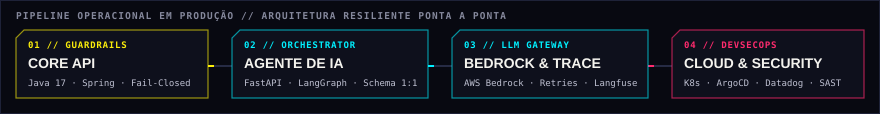
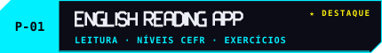
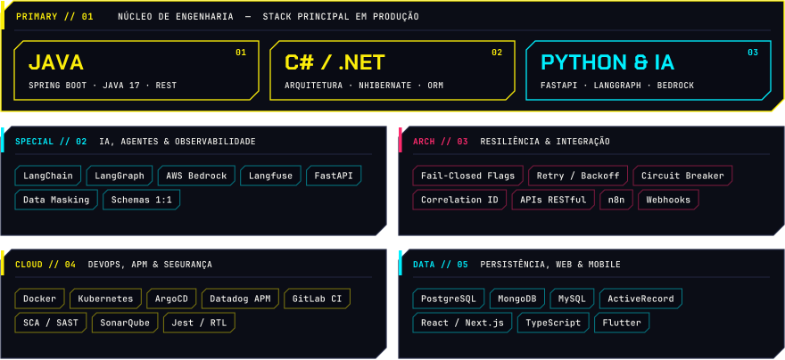

  
  
<b>Back-end resiliente, integrações corporativas e orquestração de agentes de IA em produção.</b> 
  Atualmente na <b>Develcode</b> em squads da <b>RD Saúde</b> e da <b>Leroy Merlin</b> · Portfólio interativo bilíngue (<code>PT/EN</code> + terminal <code>Ctrl+K</code>)

  
  
  

 

Sou **Guilherme Damasceno**, desenvolvedor full stack na **Develcode**, atuando em squads da **RD Saúde** e da **Leroy Merlin**. Construo e sustento APIs, integrações críticas, modernização de sistemas legados e agentes de IA corporativos com **Java / Spring Boot**, **C# / .NET** e **Python / FastAPI**, apoiado por automação com **n8n** e observabilidade em nuvem.

 

- **Guardrails & API Core (`Java 17` · `Spring Boot`):** validação estrita de campos obrigatórios na geração/validação de histórias por IA, explicação estruturada de falhas, bloqueio preventivo de cards e *feature flags* em modo **fail-closed**.
- **Orquestração & Gateway LLM (`Python` · `FastAPI` · `LangChain/LangGraph` · `AWS Bedrock`):** integração com *correlation ID* ponta a ponta, *timeouts* configuráveis, tratamento controlado de erros HTTP, rastreabilidade no **Langfuse** e mascaramento de dados sensíveis.
- **Resiliência & Qualidade (`1:1 Schema` · `SCA/SAST`):** *retries* para *throttling*, *schemas* tolerantes e validação 1:1 que eliminou a perda de critérios de aceite; ampliação de testes (`Jest` / `RTL`), correção de vulnerabilidades de dependências e mitigação de **XSS** e **Log Injection**.
- **Entrega & Observabilidade:** suporte a CI/CD, *releases* e operação com **Docker**, **Kubernetes**, **ArgoCD**, **GitLab CI** e **Datadog APM**.

<table>
  <tr>
    <td width="50%" valign="top">
      
      
<b>Contexto ·</b> sustentação e evolução de sistemas corporativos legados. 
      <b>Entrega ·</b> refatorações direcionadas em <b>C#</b> e <b>.NET</b> aplicando padrões de projeto, modelagem de persistência com <b>ActiveRecord / NHibernate</b> e <b>PostgreSQL</b> e diagnóstico de integridade de dados e regras de negócio.

    </td>
    <td width="50%" valign="top">
      
      
<b>Contexto ·</b> rotinas operacionais manuais e comunicação entre serviços. 
      <b>Entrega ·</b> criação de fluxos automatizados e integrações com <b>n8n</b>, <b>Python</b>, <b>JavaScript</b> e <b>IA assistiva</b> para eliminar trabalho repetitivo e acelerar entregas entre equipes.

    </td>
  </tr>
</table>

 

<table>
  <tr>
    <td width="50%" valign="top">
      
      
Web app de leitura em inglês com histórias graduadas, filtros por categoria e nível CEFR e exercícios interativos de lacunas (<code>TypeScript</code> · <code>HTML/CSS</code>). 
      <a href="https://english-reading-app.pages.dev"><b>ABRIR APP LIVE ↗</b></a> · <a href="https://github.com/Guilhermedms7/english-reading-app">CÓDIGO ↗</a>

    </td>
    <td width="50%" valign="top">
      
      
E-commerce full stack com catálogo, busca, ofertas e carrinho integrado a API REST e banco NoSQL (<code>React</code> · <code>FastAPI</code> · <code>MongoDB</code>). 
      <a href="https://github.com/Guilhermedms7/DMSTECH2.0">VER REPOSITÓRIO ↗</a>

    </td>
  </tr>
  <tr>
    <td width="50%" valign="top">
      
      
Sistema full stack para gestão de acervo e usuários com operações completas de CRUD (<code>React</code> · <code>Node.js</code> · <code>Express</code> · <code>MySQL</code>). 
      <a href="https://github.com/Guilhermedms7/DMSBOOKS">VER REPOSITÓRIO ↗</a>

    </td>
    <td width="50%" valign="top">
      
      
Aplicativo mobile multiplataforma de delivery com autenticação, categorias, carrinho e tema escuro (<code>Flutter</code> · <code>Dart</code>). 
      <a href="https://github.com/Guilhermedms7/DMSPIBURGUER">VER REPOSITÓRIO ↗</a>

    </td>
  </tr>
  <tr>
    <td width="50%" valign="top">
      
      
Jogo diário de palavras no navegador com suporte aos modos Termo, Dueto e Quarteto (<code>JavaScript</code> · <code>HTML</code> · <code>CSS</code>). 
      <a href="https://github.com/Guilhermedms7/Termo">VER REPOSITÓRIO ↗</a>

    </td>
    <td width="50%" valign="top">
      
      
Simulação de domínio bancário com clientes, agências, contas, saldo, extrato e regras de movimentação (<code>Python</code>). 
      <a href="https://github.com/Guilhermedms7/Sistema_bancario">VER REPOSITÓRIO ↗</a>

    </td>
  </tr>
</table>

 

 

  
Aberto a conversas sobre oportunidades em engenharia de software, arquitetura back-end, integrações e IA aplicada.

  
  
  
  
    
  

